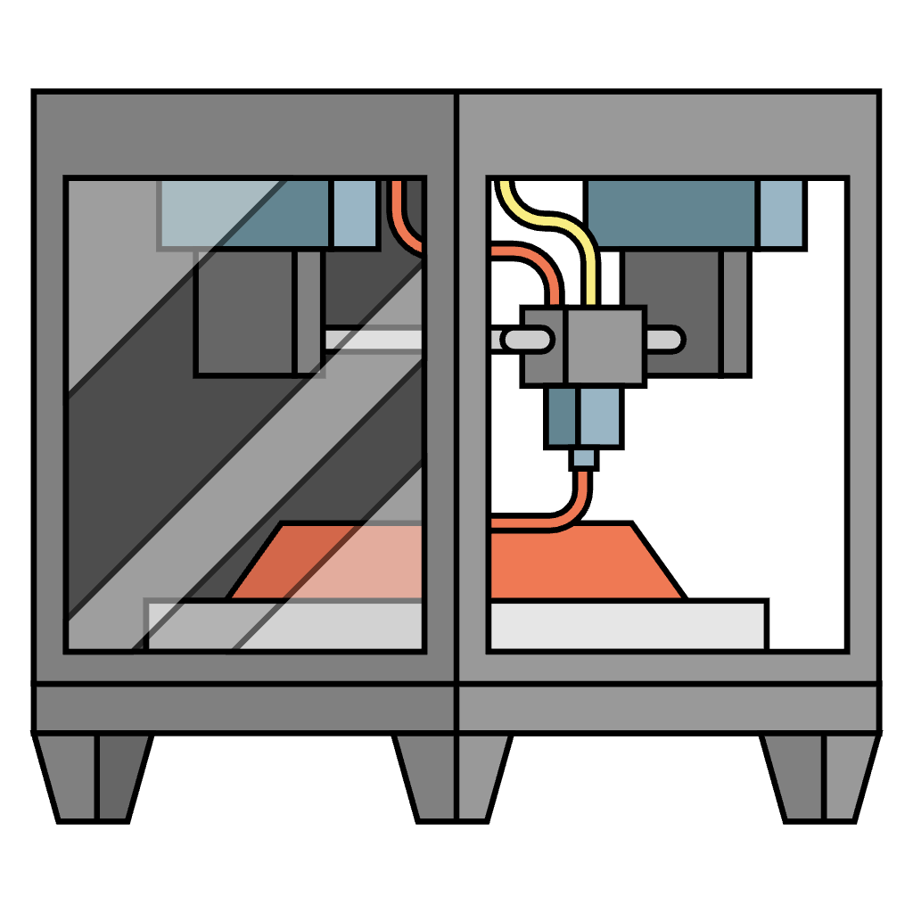
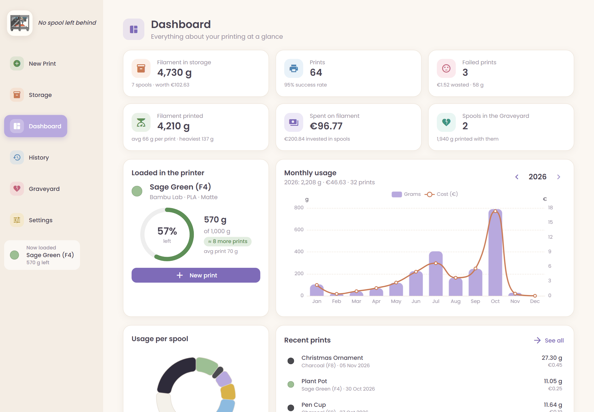
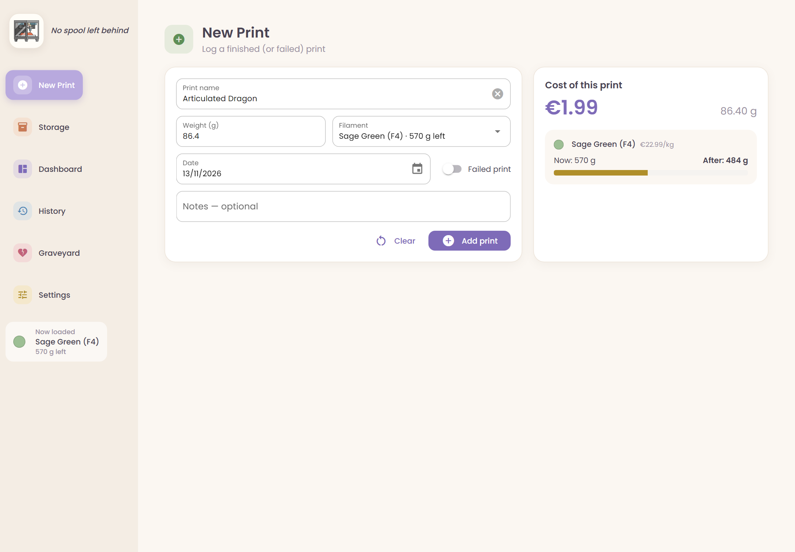
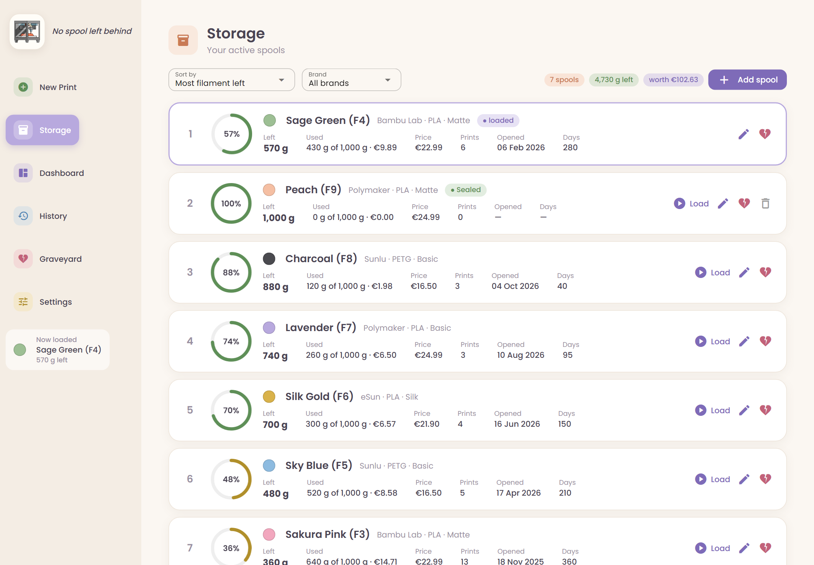
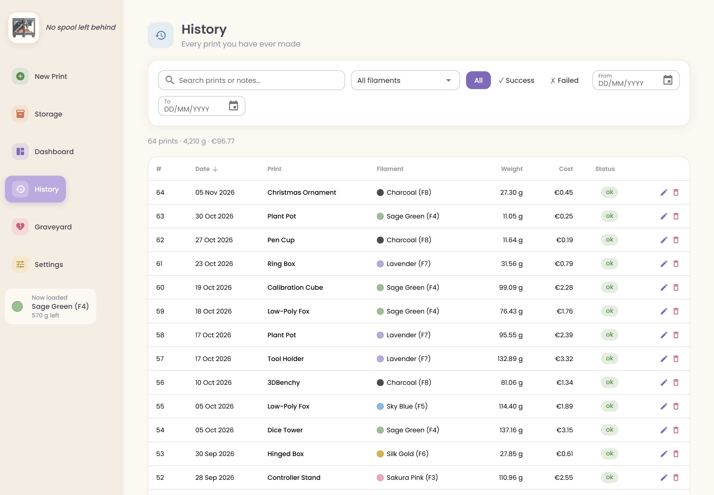
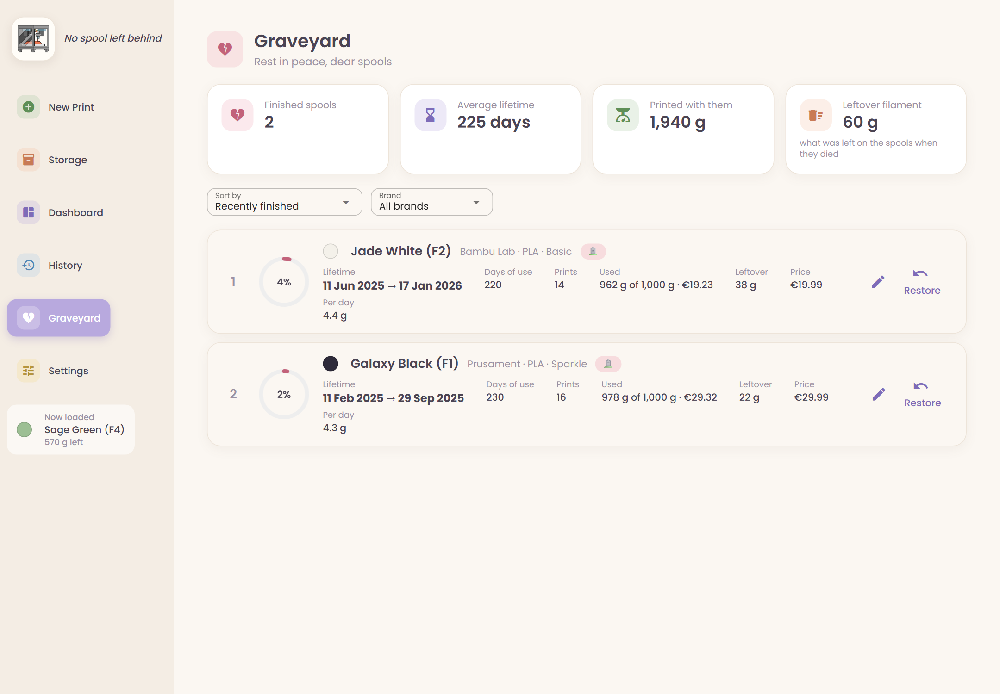
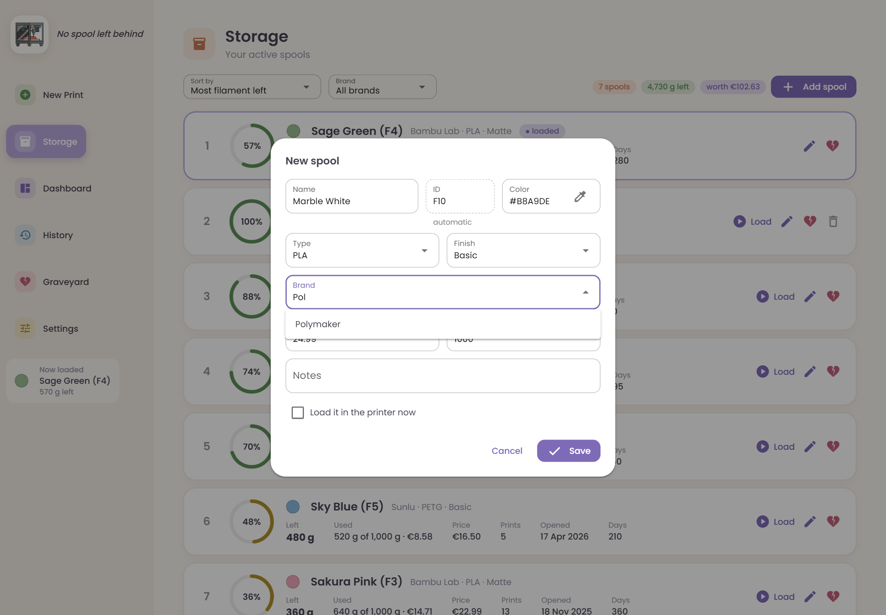
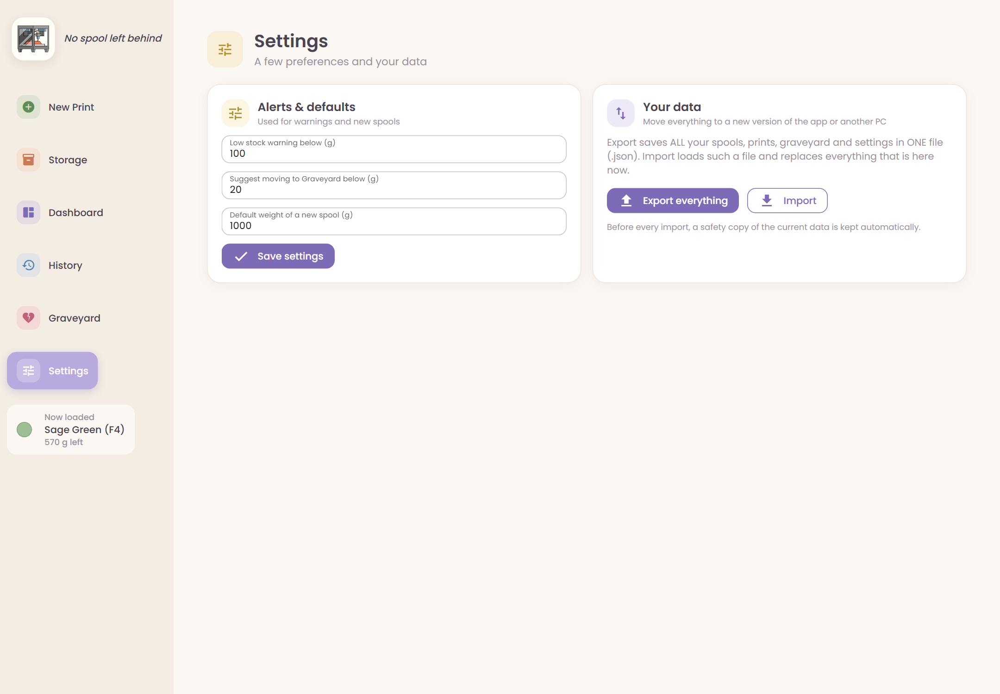

<div align="center">



# Spool Buddy

**Track your spools, prints and filament costs — no spool left behind!** 🧵

A cozy little desktop app for 3D printing hobbyists. Log every print, see how much filament
is left on each spool, what your prints cost, and when it's time to open a new one.

[](https://github.com/LordOfGeeks95/spool-buddy/releases/latest)




</div>

---

## ✨ Features

- **🧾 Log prints in seconds** — name, weight, filament, date. The cost and the filament left
  on the spool update **live** while you type.
- **📦 Storage** — all your spools in one list with a ring showing how much is left, how much
  you've used and what it cost. Sort by filament left, brand, price, ID… and filter by brand.
- **🏷️ Unique spool IDs** — every spool gets an automatic ID (`F1`, `F2`, `F3`…), so you can
  have five "Black" spools and never mix them up. Write the ID on the spool and you're done.
- **🟢 Sealed → Loaded** — new spools are marked *Sealed*. The day you press **Load**
  becomes the spool's "opened" date.
- **⚠️ Low-stock warnings** — get warned when a spool is running low, when a print needs more
  filament than is left, and a nudge to retire a spool when it's almost empty.
- **🪦 Graveyard** — finished spools rest here with their full life story: how long they lasted,
  how many prints they made and how much filament was left over.
- **📊 Dashboard** — totals at a glance, monthly usage per year, usage per spool (in each
  spool's own color), recent prints and failed-print stats.
- **🔎 History** — every print ever, with search, filters, edit and delete.
- **💾 Your data, your file** — export **everything** to a single readable `.json` file and
  import it again on another PC or in a newer version of the app.
- **🔒 100% local & private** — no account, no cloud, no internet needed. Your data stays
  in a folder next to the app.

## 📸 Screenshots

| New print — live cost preview | Storage |
|:---:|:---:|
|  |  |
| **History** | **Graveyard** |
|  |  |
| **Adding a spool (with brand suggestions)** | **Settings — export / import** |
|  |  |

## 🚀 Download & run (no Python needed)

1. Go to the [**latest release**](https://github.com/LordOfGeeks95/spool-buddy/releases/latest)
   and download **`SpoolBuddy.exe`**.
2. Put it in a folder of its own (e.g. `Documents\Spool Buddy\`).
3. Double-click it. That's it! 🎉

> **"Windows protected your PC"?** The app isn't code-signed (signing certificates cost money),
> so SmartScreen may warn you the first time. Click **More info → Run anyway**.
> If you'd rather not trust a downloaded exe, [run it from source](#-run-from-source) instead.

The first start takes a few seconds (the single-file exe unpacks itself every time it starts).

## 🧭 How it works

1. **Add your spools** in **Storage** → *Add spool*. Type the color (e.g. `Black`), brand,
   type, price and weight. The ID (`F1`, `F2`…) is assigned automatically.
2. **Load** the spool that's in your printer. It moves to the top and gets its "opened" date.
3. **Log each print** in **New Print**: name + weight (grams, e.g. from your slicer).
   The loaded spool is pre-selected.
4. When a spool is empty, send it to the **Graveyard** 🪦 (the app will suggest it).

**How the numbers are calculated**

- Print cost = `weight (g) × spool price per kg ÷ 1000`
- Filament left = `spool weight − sum of all prints on that spool`
- Each print remembers the price *at the time it was printed*, so changing a spool's price
  later never rewrites old costs.

## 💾 Your data

All your data lives in a **`data`** folder created **next to the app** the first time you open it:

```
Spool Buddy\
├── SpoolBuddy.exe
└── data\
    ├── filament.db      ← everything (a single SQLite file)
    ├── backups\         ← automatic backups (one per start, the last 20 are kept)
    └── log.txt          ← only useful if something goes wrong
```

- **Backup by hand:** copy the `data` folder.
- **Move to another PC / a new version:** *Settings → Export everything* creates one `.json` file.
  On the other side: *Settings → Import*. A safety backup is always made before importing.
- **Start fresh:** delete (or rename) the `data` folder.
- **Updating the app:** replace only `SpoolBuddy.exe` and keep the `data` folder.
  The database is upgraded automatically.

## 🛠️ Run from source

You need **Python 3.10+** ([python.org](https://www.python.org/downloads/)) on Windows.

```bash
git clone https://github.com/LordOfGeeks95/spool-buddy.git
cd spool-buddy
run.bat
```

`run.bat` creates a virtual environment and installs everything the first time.
Or manually:

```bash
python -m venv .venv
.venv\Scripts\python.exe -m pip install -r requirements.txt
.venv\Scripts\python.exe main.py
```

| Command | What it does |
|---|---|
| `python main.py` | Opens the app in its own window |
| `python main.py --browser` | Opens the app in your web browser instead |

### Build the `.exe` yourself

```bash
build.bat
```

This creates `release\SpoolBuddy.exe` (a single file, no data inside) using PyInstaller.

## 🧱 Built with

- [NiceGUI](https://nicegui.io/) — the UI (with Quasar & ECharts under the hood)
- [pywebview](https://pywebview.flowrl.com/) — the native desktop window
- [SQLite](https://www.sqlite.org/) — the database (built into Python)
- [PyInstaller](https://pyinstaller.org/) — packaging into a single `.exe`
- Fonts: [Poppins](https://fonts.google.com/specimen/Poppins) & [Arimo](https://fonts.google.com/specimen/Arimo) ·
  Icons: [Material Icons](https://fonts.google.com/icons)

<details>
<summary><b>Project structure</b></summary>

```
main.py              entry point (backup → database → window)
app/
├── config.py        paths, app name, default settings
├── theme.py         colors, fonts, CSS
├── db.py            SQLite schema + migrations
├── services.py      all the logic & calculations (pages never touch SQL)
├── transfer.py      export / import (.json)
├── backup.py        automatic backups
└── ui/              one file per page (+ shared layout pieces)
tools/
├── build_exe.py     builds the .exe
└── make_icon.py     icon.png → icon.ico
assets/              app icon
```

</details>

## 📄 License

[MIT](LICENSE) — free to use, modify and share. Happy printing! 🖨️
